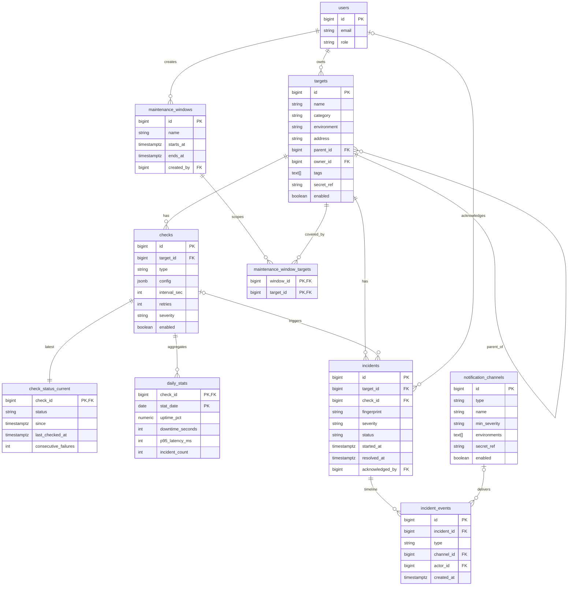
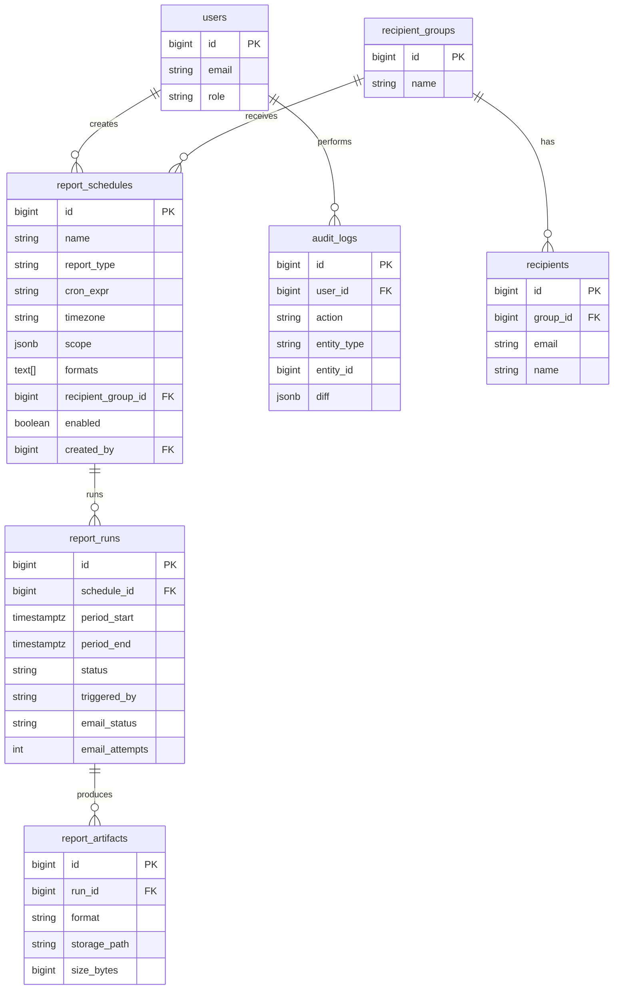

# Dokumen Arsitektur — Aplikasi Monitoring Internal (Web)

*Versi 0.1 (draft) · 15 Oktober 2026 · Dokumen terkait: PRD Aplikasi Monitoring Internal Kantor*

## 1. Tujuan dan ruang lingkup

Dokumen ini menjelaskan arsitektur teknis aplikasi monitoring internal: komponen, alur data, desain tiap modul, model data (ERD), keamanan, deployment, dan keandalan. Kebutuhan produk ada di PRD.

## 2. Keputusan arsitektur utama

| ID | Keputusan | Alasan | Konsekuensi |
| --- | --- | --- | --- |
| A1 | Hybrid: control plane custom (Go) + Prometheus sebagai mesin pengecekan | Scheduler, retry, dan penyimpanan time-series tidak perlu ditulis ulang; fokus pada CRUD, dashboard, incident, dan report | Konfigurasi Prometheus harus di-generate dari database |
| A2 | Check yang tidak dicakup blackbox dan SNMP dibuat sebagai exporter Go (custom checker) | Expiry domain, SMTP/IMAP, S3, login DB, dan Beszel tetap masuk satu model metrik | Satu binary tambahan yang dipelihara |
| A3 | Postgres untuk konfigurasi, incident, dan rollup; Prometheus untuk time-series jangka pendek | Memisahkan beban dan kebutuhan retensi | Dua penyimpanan |
| A4 | Report dibaca dari rollup harian di Postgres, bukan dari Prometheus | Report bulanan tidak bergantung retensi dan bisa digenerate ulang | Perlu job rollup harian |
| A5 | Seluruh engine ditempatkan di jaringan kantor | Probe harus menjangkau LAN dan server internal | Hanya UI yang diekspos |
| A6 | Alert kritikal lewat Telegram; report lewat SMTP relay | Menghindari ketergantungan melingkar dengan mail server yang dipantau | Perlu bot Telegram dan relay |
| A7 | Secret di Vault; database hanya menyimpan referensi | Tidak ada kredensial di tabel atau file konfigurasi | Aplikasi bergantung pada Vault |
| A8 | Konfigurasi engine di-generate dari database (UI, DB, file\_sd dan rules, reload) | Database menjadi sumber kebenaran; engine dapat dibangun ulang kapan saja | Perlu validasi sebelum reload |

## 3. Gambaran arsitektur

Arsitektur terdiri dari lima lapisan. Control plane adalah aplikasi Go yang dibangun sendiri; mesin monitoring memakai komponen open source.

| Lapisan | Komponen | Tanggung jawab |
| --- | --- | --- |
| Presentasi | Web UI | Dashboard, CRUD, incident, report dan jadwal, administrasi |
| Control plane (Go) | API server | REST API, auth dan RBAC, audit, status syncer, config generator |
| Control plane (Go) | Incident manager | Webhook Alertmanager, lifecycle incident, maintenance window, notifikasi |
| Control plane (Go) | Report engine | Scheduler, aggregator, renderer, mailer |
| Control plane (Go) | Rollup job | Membuat statistik harian ke Postgres |
| Mesin monitoring | Prometheus + Alertmanager | Scrape, time-series, evaluasi rule, routing alert |
| Mesin monitoring | blackbox\_exporter | ICMP, TCP, HTTP(S), DNS, TLS |
| Mesin monitoring | snmp\_exporter | Router, switch, AP |
| Mesin monitoring | Custom checker (Go) | RDAP, SMTP/IMAP, S3, SQL, Beszel |
| Data | Postgres | Konfigurasi, incident, rollup, jadwal dan riwayat report, audit |
| Data | Report storage | File PDF, CSV, HTML hasil report |
| Data | Vault | Kredensial |
| Eksternal | Target | Network, website, domain, database, mail, S3, hub Beszel |
| Eksternal | Telegram API dan SMTP relay | Pengiriman alert dan report |

Alur ringkas:

- Konfigurasi: Web UI, API server, Postgres, lalu config generator menulis file\_sd dan rules untuk Prometheus.
- Pengecekan: Prometheus men-scrape exporter, exporter memeriksa target.
- Alert: Prometheus, Alertmanager, webhook, Incident manager, lalu Telegram atau email.
- Report: Rollup job mengisi `daily_stats`; Report engine membaca Postgres, merender, lalu mengirim lewat SMTP relay.

## 4. Alur data utama

### 4.1 Pengelolaan target

1. Editor menyimpan target dan check lewat UI.
2. API server memvalidasi, menyimpan ke Postgres, dan mencatat audit log.
3. Config generator menulis file\_sd per jenis check (blackbox, snmp, custom) dan file rule alert secara atomik, memvalidasi dengan `promtool`, lalu me-reload Prometheus.
4. Custom checker mengambil daftar check dari API dan menjalankannya sesuai interval.

### 4.2 Pengecekan dan status

Prometheus men-scrape blackbox\_exporter, snmp\_exporter, dan custom checker. Status syncer di API server memperbarui `check_status_current` secara berkala lewat query PromQL. Dashboard membaca tabel itu untuk status cepat dan PromQL untuk grafik.

### 4.3 Alert dan incident

1. Prometheus mengevaluasi rule: down setelah N kegagalan beruntun, latency tinggi, mendekati expiry, resource kritis.
2. Alertmanager mengelompokkan dan merutekan berdasarkan label `environment` dan `severity`, menerapkan inhibit rule parent-child, lalu memanggil webhook Incident manager.
3. Incident manager membuat atau memperbarui incident (deduplikasi lewat `fingerprint`), memeriksa maintenance window, mengirim notifikasi ke channel yang sesuai, dan mencatat event.
4. Saat alert resolve, incident ditutup dan notifikasi resolve dikirim.

### 4.4 Rollup harian

Job malam hari (mis. 00:30 sesuai timezone) menghitung per check untuk hari sebelumnya: uptime, detik downtime, rata-rata dan p95 latency, jumlah incident, dan detik maintenance. Hasilnya di-upsert ke `daily_stats`.

### 4.5 Report terjadwal

1. Scheduler mengambil jadwal aktif dari `report_schedules` dan memicu run pada waktu cron dalam timezone jadwal.
2. Periode ditentukan tetap: kemarin, Senin-Minggu lalu, atau bulan kalender lalu.
3. Aggregator mengambil `daily_stats` dan `incidents` sesuai scope.
4. Renderer membuat HTML (body email) serta PDF dan CSV, lalu menyimpannya ke report storage.
5. Mailer mengirim lewat SMTP relay dengan retry; status dicatat di `report_runs`.

## 5. Desain komponen

### 5.1 Web UI

Halaman: Overview, Network, Aplikasi/Domain/Database, Mail/S3/Server, Target (CRUD), Incident, Maintenance, Report dan Jadwal, Administrasi. Usulan teknologi: React + Vite + TypeScript, TanStack Query untuk pengambilan data, dan pustaka chart seperti ECharts atau Recharts. Sesi memakai cookie HttpOnly. Build statis disajikan oleh API server atau nginx.

### 5.2 API server (Go)

Modul: auth, targets, checks, dashboards, incidents, maintenance, reports, admin, webhook. REST + JSON dengan dokumentasi OpenAPI. Migrasi database memakai `goose` atau `golang-migrate`.

| Endpoint | Fungsi |
| --- | --- |
| `POST /api/v1/auth/login`, `POST /api/v1/auth/logout` | Sesi pengguna |
| `GET/POST /api/v1/targets`, `GET/PUT/DELETE /api/v1/targets/{id}` | CRUD target |
| `POST /api/v1/checks/test` | Uji check sebelum disimpan |
| `GET /api/v1/dashboards/{overview\|network\|apps\|mail-s3-server}` | Data dashboard |
| `GET /api/v1/targets/{id}/metrics?range=24h` | Grafik target |
| `GET /api/v1/incidents`, `POST /api/v1/incidents/{id}/ack` | Daftar dan acknowledge incident |
| `POST /api/v1/webhooks/alertmanager` | Webhook Alertmanager (dengan token) |
| `CRUD /api/v1/maintenance-windows` | Maintenance window |
| `CRUD /api/v1/report-schedules`, `POST /api/v1/report-schedules/{id}/run` | Jadwal report dan Run now |
| `GET /api/v1/report-runs`, `GET /api/v1/report-runs/{id}/artifacts/{format}` | Riwayat dan unduh report |
| `CRUD /api/v1/notification-channels`, `/recipient-groups` | Channel dan penerima |
| `GET /api/v1/audit-logs` | Audit log |
| `GET /healthz`, `GET /readyz`, `GET /metrics` | Health dan metrik aplikasi |

### 5.3 Config generator

- Menulis ke file sementara lalu rename (atomik).
- Memvalidasi dengan `promtool check config` dan `promtool check rules` sebelum reload.
- Me-reload Prometheus lewat endpoint lifecycle (`/-/reload`).
- Bila validasi gagal, konfigurasi lama dipertahankan dan error ditampilkan di UI.
- Label wajib pada tiap target: `target_id`, `check_id`, `category`, `environment`, `severity`.

### 5.4 Custom checker (Go)

Mengekspos `/metrics`. Tiap jenis check adalah modul dengan interface yang sama (menerima config, menjalankan, mengembalikan hasil). Awalan metrik `mon_`.

| Check | Implementasi | Keluaran utama |
| --- | --- | --- |
| ICMP, TCP, HTTP(S), DNS | blackbox\_exporter | `probe_success`, `probe_duration_seconds`, `probe_http_status_code`, `probe_ssl_earliest_cert_expiry` |
| SNMP | snmp\_exporter | Status interface, traffic, error, uptime (mis. `ifOperStatus`, `ifHCInOctets`, `sysUpTime`); sesuaikan modul per vendor |
| Expiry domain | Custom checker (RDAP, fallback WHOIS) | `mon_domain_expiry_days` |
| SMTP/IMAP | Custom checker | `mon_mail_up`, `mon_mail_latency_seconds`, `mon_mail_cert_expiry_days` |
| S3 | Custom checker (S3 API) | `mon_s3_up`, `mon_s3_op_latency_seconds` |
| SQL | Custom checker (driver DB, akun read-only) | `mon_db_up`, `mon_db_query_latency_seconds` |
| Beszel | Custom checker (API hub Beszel) | `mon_beszel_system_up` dan gauge CPU, memori, disk |

Catatan: ICMP di container membutuhkan `CAP_NET_RAW` atau pengaturan `net.ipv4.ping_group_range`.

### 5.5 Incident manager

- State machine: open, acknowledged, resolved.
- Deduplikasi lewat `fingerprint` dari Alertmanager; hanya satu incident non-resolved per fingerprint.
- Alert yang jatuh dalam maintenance window ditandai `suppressed` dan tidak dinotifikasi.
- Routing notifikasi per channel memakai `min_severity` dan `environments`.
- Telegram lewat Bot API; email lewat SMTP relay. Setiap pengiriman dicatat sebagai `incident_events`.
- Webhook dilindungi token.

### 5.6 Report engine

- Scheduler dinamis (mis. `robfig/cron`) yang memuat ulang jadwal saat berubah.
- Idempotency: unique `(schedule_id, period_start)` pada `report_runs`.
- Catch-up: saat start, jalankan periode yang terlewat.
- Multi-instance: leader lock memakai Postgres advisory lock.
- PDF dirender dengan headless Chromium (mis. `chromedp`); chart dirender di server sebagai gambar inline.
- Email: body HTML ringkas plus lampiran; retry dengan exponential backoff; bila lampiran melebihi batas, kirim link ke dashboard.

### 5.7 Rollup job

- Uptime check = rata-rata `probe_success` (atau metrik up setara) selama hari tersebut, dikurangi periode maintenance.
- Latency dihitung dari metrik durasi; incident dihitung dari tabel `incidents`.
- Job idempotent: menghitung ulang satu hari menghasilkan nilai yang sama (upsert).

## 6. Model data dan ERD

### 6.1 Diagram ERD

Diagram di bawah menampilkan kolom kunci saja. Kolom lengkap ada di kamus data (bagian 6.3).

ERD 1: inti monitoring (target, check, status, incident, maintenance window, channel notifikasi).

ERD 2: report terjadwal dan administrasi.

Tabel `users` muncul di kedua diagram karena dirujuk dari banyak tabel.

### 6.2 Relasi utama

| Entitas A | Kardinalitas | Entitas B | Keterangan |
| --- | --- | --- | --- |
| `users` | 1 : N | `targets` | Owner target |
| `targets` | 1 : N | `targets` | Parent-child (self-reference) |
| `targets` | 1 : N | `checks` | Satu target banyak check |
| `checks` | 1 : 1 | `check_status_current` | Status terkini |
| `targets` | 1 : N | `incidents` | Incident per target |
| `checks` | 1 : N | `incidents` | Check pemicu (opsional) |
| `users` | 1 : N | `incidents` | Pengguna yang acknowledge |
| `incidents` | 1 : N | `incident_events` | Timeline |
| `notification_channels` | 1 : N | `incident_events` | Event notifikasi lewat channel |
| `maintenance_windows` | N : M | `targets` | Lewat `maintenance_window_targets` |
| `users` | 1 : N | `maintenance_windows` | Pembuat |
| `checks` | 1 : N | `daily_stats` | Statistik per hari |
| `recipient_groups` | 1 : N | `recipients` | Anggota grup |
| `recipient_groups` | 1 : N | `report_schedules` | Penerima jadwal |
| `users` | 1 : N | `report_schedules` | Pembuat jadwal |
| `report_schedules` | 1 : N | `report_runs` | Riwayat eksekusi |
| `report_runs` | 1 : N | `report_artifacts` | File hasil |
| `users` | 1 : N | `audit_logs` | Pelaku perubahan |

### 6.3 Kamus data

Semua tabel memakai `id bigint` (identity) sebagai primary key kecuali dinyatakan lain, dan `timestamptz` untuk waktu.

| Tabel | Kolom | Catatan |
| --- | --- | --- |
| `users` | `id`, `email`, `name`, `password_hash`, `role`, `is_active`, `last_login_at`, `created_at` | `email` unik; login lokal, SSO menyusul |
| `targets` | `id`, `name`, `category`, `environment`, `address`, `parent_id` (FK targets), `owner_id` (FK users), `tags` (text\[\]), `secret_ref`, `enabled`, `created_at`, `updated_at` | Unik (`name`, `environment`); `secret_ref` berisi path Vault |
| `checks` | `id`, `target_id` (FK), `type`, `config` (jsonb), `interval_sec`, `timeout_ms`, `retries`, `severity`, `enabled` | Config sesuai tipe check |
| `check_status_current` | `check_id` (PK, FK), `status`, `since`, `last_checked_at`, `last_latency_ms`, `last_error`, `consecutive_failures` | Cache untuk dashboard; diisi status syncer |
| `incidents` | `id`, `target_id` (FK), `check_id` (FK, nullable), `fingerprint`, `severity`, `status`, `title`, `started_at`, `acknowledged_at`, `acknowledged_by` (FK users), `resolved_at`, `suppressed` | Unik parsial pada `fingerprint` untuk status bukan resolved |
| `incident_events` | `id`, `incident_id` (FK), `type`, `message`, `channel_id` (FK, nullable), `actor_id` (FK users, nullable), `created_at` | Timeline dan log notifikasi |
| `maintenance_windows` | `id`, `name`, `starts_at`, `ends_at`, `recurrence` (RRULE, nullable), `created_by` (FK users), `created_at` | Dikecualikan dari SLA |
| `maintenance_window_targets` | `window_id` (FK), `target_id` (FK) | PK gabungan |
| `notification_channels` | `id`, `type`, `name`, `min_severity`, `environments` (text\[\]), `secret_ref`, `enabled` | Token bot atau SMTP di Vault |
| `daily_stats` | `check_id` (FK), `stat_date`, `uptime_pct`, `downtime_seconds`, `checks_total`, `checks_failed`, `avg_latency_ms`, `p95_latency_ms`, `incident_count`, `maintenance_seconds` | PK (`check_id`, `stat_date`) |
| `report_schedules` | `id`, `name`, `report_type`, `cron_expr`, `timezone`, `scope` (jsonb), `formats` (text\[\]), `recipient_group_id` (FK), `enabled`, `next_run_at`, `last_run_at`, `created_by` (FK users) | `scope` berisi filter kategori, environment, tag, atau target |
| `recipient_groups` | `id`, `name` |  |
| `recipients` | `id`, `group_id` (FK), `email`, `name` | Unik (`group_id`, `email`) |
| `report_runs` | `id`, `schedule_id` (FK), `period_start`, `period_end`, `status`, `triggered_by`, `started_at`, `finished_at`, `email_status`, `email_attempts`, `error` | Unik (`schedule_id`, `period_start`) |
| `report_artifacts` | `id`, `run_id` (FK), `format`, `storage_path`, `size_bytes`, `sha256`, `created_at` | Satu run banyak format |
| `audit_logs` | `id`, `user_id` (FK), `action`, `entity_type`, `entity_id`, `diff` (jsonb), `ip`, `created_at` | Append-only |

### 6.4 Nilai enum

| Kolom | Nilai |
| --- | --- |
| `users.role` | admin, editor, viewer |
| `targets.category` | network\_device, internal\_server, website, domain, database, mail\_server, s3, beszel\_system |
| `targets.environment` | production, staging, development, internal |
| `checks.type` | icmp, tcp, http, dns, tls, snmp, rdap, smtp, imap, s3, sql, beszel |
| `checks.severity`, `incidents.severity` | critical, warning, info |
| `check_status_current.status` | up, down, degraded, unknown |
| `incidents.status` | open, acknowledged, resolved |
| `incident_events.type` | opened, notified, acknowledged, note, suppressed, resolved |
| `notification_channels.type` | telegram, email, slack |
| `report_schedules.report_type` | daily, weekly, monthly, custom |
| `report_runs.status` | queued, running, success, failed |
| `report_runs.triggered_by` | cron, manual, catchup |

### 6.5 Indeks, constraint, dan retensi

- Indeks: `targets(category, environment)`, GIN pada `targets.tags`, `checks(target_id)`, `incidents(status, severity)`, `incidents(target_id, started_at desc)`, `daily_stats(stat_date)`, `audit_logs(created_at)`.
- Constraint: foreign key dengan `ON DELETE RESTRICT` untuk data historis; hapus target dilakukan sebagai nonaktif (soft delete) bila sudah punya incident atau statistik.
- Retensi (usulan): `daily_stats`, `report_runs`, dan `report_artifacts` minimal 13 bulan; `incidents` dan `audit_logs` minimal 24 bulan; time-series Prometheus 15-30 hari.

## 7. Keamanan

| Aksi | Admin | Editor | Viewer |
| --- | --- | --- | --- |
| Lihat dashboard, incident, dan report | Ya | Ya | Ya |
| CRUD target dan check | Ya | Ya | Tidak |
| Acknowledge incident dan maintenance window | Ya | Ya | Tidak |
| Kelola jadwal report dan penerima | Ya | Ya | Tidak |
| Kelola channel notifikasi | Ya | Tidak | Tidak |
| Kelola user dan lihat audit log | Ya | Tidak | Tidak |

- Autentikasi: login lokal dengan password di-hash (argon2id atau bcrypt), rate limit login, cookie HttpOnly dan SameSite, proteksi CSRF; SSO (OIDC/LDAP) sebagai pengembangan lanjutan.
- Secret: semua kredensial di Vault; aplikasi memakai akses dengan hak minimum (AppRole atau token terbatas); database hanya menyimpan `secret_ref`.
- Akses target: akun read-only untuk check database; kredensial SNMP dan S3 dengan hak minimum.
- Jaringan: komponen engine hanya di jaringan kantor; hanya UI yang diekspos lewat reverse proxy dengan TLS; Prometheus, Alertmanager, dan exporter tidak diekspos.
- Data: report tidak memuat kredensial; webhook Alertmanager dilindungi token; audit log append-only.
- Hardening UI: header keamanan (CSP, HSTS), validasi input di server, dan logging terstruktur tanpa data sensitif.

## 8. Deployment dan infrastruktur

| Layanan | Artefak | Catatan |
| --- | --- | --- |
| `web` | Build statis | Disajikan oleh API server atau nginx |
| `api` | Binary Go (image di registry) | Stateless; leader lock untuk scheduler |
| `checker` | Binary Go | Dapat dipisah per segmen jaringan |
| `prometheus` | Image resmi | Retensi 15-30 hari; lifecycle reload aktif |
| `alertmanager` | Image resmi | Routing per `environment` dan `severity` |
| `blackbox`, `snmp_exporter` | Image resmi | `CAP_NET_RAW` untuk ICMP |
| `postgres` | Image resmi | Volume persisten dan backup |
| `renderer` | Headless Chromium | Opsional sebagai sidecar |
| `vault` | Instance yang sudah ada | AppRole atau token terbatas |

- Lingkungan: Docker Compose pada satu host di jaringan kantor untuk skala awal; dapat dipecah per komponen bila skala bertambah.
- CI/CD: pipeline Jenkins (lint, test, build image, push ke registry, deploy), migrasi database dijalankan otomatis sebelum rilis.
- Akses: reverse proxy (mis. HAProxy) dengan TLS di depan UI.
- Backup: dump Postgres harian dan salinan volume report storage; uji restore berkala. Konfigurasi Prometheus dapat dibangun ulang dari database.
- Kapasitas awal (usulan): 4 vCPU, 8 GB RAM, 100 GB SSD untuk hingga 500 target.

## 9. Keandalan dan observabilitas aplikasi

- Endpoint `/healthz` dan `/readyz` pada API server dan custom checker; `/metrics` untuk semua komponen aplikasi.
- Prometheus memantau komponennya sendiri; alert untuk Alertmanager, exporter, dan custom checker yang tidak merespons.
- Alert `Watchdog` selalu aktif dan dikirim ke heartbeat eksternal agar kematian seluruh stack terdeteksi.
- Degradasi bertahap: bila Prometheus tidak tersedia, dashboard menampilkan status terakhir dari `check_status_current` dengan penanda data kedaluwarsa.
- Kegagalan report ditampilkan di dashboard (`report_runs`) dan dinotifikasi lewat channel non-email.
- Log terstruktur (JSON) dengan correlation ID.

## 10. Risiko teknis dan mitigasi

| Risiko | Mitigasi |
| --- | --- |
| Konfigurasi Prometheus rusak setelah perubahan target | Validasi `promtool`, penulisan atomik, rollback ke konfigurasi lama |
| Alert storm saat perangkat induk mati | Inhibit rule parent-child dan pengelompokan di Alertmanager |
| Kardinalitas metrik tinggi | Batasi label ke yang diperlukan; satu check satu seri |
| Query rentang panjang membebani Prometheus | Report memakai rollup di Postgres |
| Email report gagal saat mail server bermasalah | SMTP relay terpisah, retry, notifikasi kegagalan lewat Telegram |
| Ketergantungan pada API hub Beszel | Timeout dan status `unknown` yang jelas; alert terpisah untuk integrasi gagal |
| Kredensial bocor lewat konfigurasi | Hanya `secret_ref` di database; secret diambil saat runtime dari Vault |

## 11. Rencana implementasi teknis

Fase mengikuti PRD bagian 9. Catatan teknis per fase:

1. Fase 1: skema database inti, API target dan check, config generator, blackbox\_exporter, Alertmanager ke Incident manager, notifikasi Telegram, dashboard dasar.
2. Fase 2: custom checker (RDAP, SQL, S3, SMTP/IMAP), rollup harian ke `daily_stats`.
3. Fase 3: snmp\_exporter untuk network dan integrasi API Beszel.
4. Fase 4: report engine (scheduler, aggregator, renderer, mailer), riwayat run, dan idempotency.
5. Fase 5: inhibit rule parent-child, maintenance window, RBAC lanjutan, dan pengerasan keamanan.
