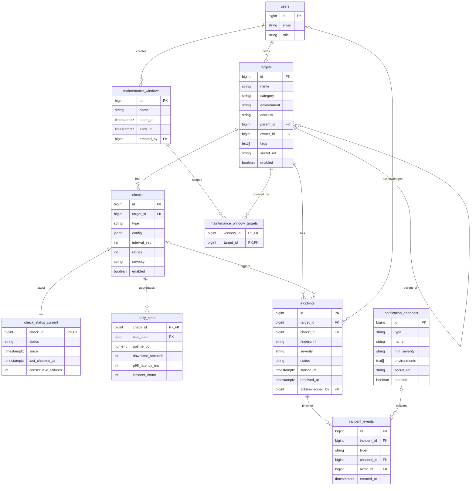
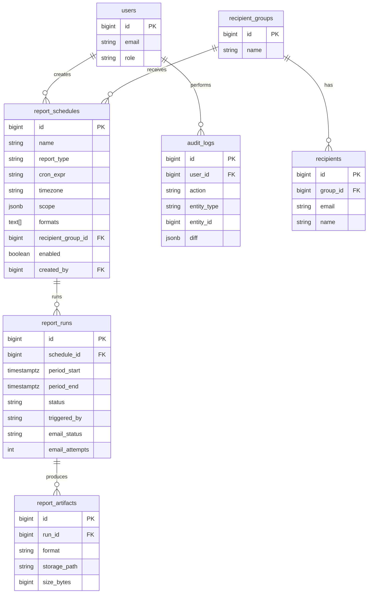

# ERD — Aplikasi Monitoring Internal Kantor

*Versi 0.1 (draft) · 15 Oktober 2026 · Dokumen terkait: PRD dan Dokumen Arsitektur Aplikasi Monitoring Internal*

Diagram ditulis dengan sintaks [Mermaid](https://mermaid.js.org) dan menampilkan kolom kunci saja. Kolom lengkap ada di kamus data (bagian 4). Diagram dipecah dua agar terbaca: inti monitoring, serta report terjadwal dan administrasi. Tabel `users` muncul di keduanya karena dirujuk dari banyak tabel.

## 1. ERD 1 — Inti monitoring

## 2. ERD 2 — Report terjadwal dan administrasi

## 3. Relasi utama

| Entitas A | Kardinalitas | Entitas B | Keterangan |
|---|---|---|---|
| `users` | 1 : N | `targets` | Owner target |
| `targets` | 1 : N | `targets` | Parent-child (self-reference) |
| `targets` | 1 : N | `checks` | Satu target banyak check |
| `checks` | 1 : 1 | `check_status_current` | Status terkini |
| `targets` | 1 : N | `incidents` | Incident per target |
| `checks` | 1 : N | `incidents` | Check pemicu (opsional) |
| `users` | 1 : N | `incidents` | Pengguna yang acknowledge |
| `incidents` | 1 : N | `incident_events` | Timeline |
| `notification_channels` | 1 : N | `incident_events` | Event notifikasi lewat channel |
| `maintenance_windows` | N : M | `targets` | Lewat `maintenance_window_targets` |
| `users` | 1 : N | `maintenance_windows` | Pembuat |
| `checks` | 1 : N | `daily_stats` | Statistik per hari |
| `recipient_groups` | 1 : N | `recipients` | Anggota grup |
| `recipient_groups` | 1 : N | `report_schedules` | Penerima jadwal |
| `users` | 1 : N | `report_schedules` | Pembuat jadwal |
| `report_schedules` | 1 : N | `report_runs` | Riwayat eksekusi |
| `report_runs` | 1 : N | `report_artifacts` | File hasil |
| `users` | 1 : N | `audit_logs` | Pelaku perubahan |

## 4. Kamus data

Semua tabel memakai `id bigint` (identity) sebagai primary key kecuali dinyatakan lain, dan `timestamptz` untuk waktu.

| Tabel | Kolom | Catatan |
|---|---|---|
| `users` | `id`, `email`, `name`, `password_hash`, `role`, `is_active`, `last_login_at`, `created_at` | `email` unik; login lokal, SSO menyusul |
| `targets` | `id`, `name`, `category`, `environment`, `address`, `parent_id` (FK targets), `owner_id` (FK users), `tags` (text[]), `secret_ref`, `enabled`, `created_at`, `updated_at` | Unik (`name`, `environment`); `secret_ref` berisi path Vault |
| `checks` | `id`, `target_id` (FK), `type`, `config` (jsonb), `interval_sec`, `timeout_ms`, `retries`, `severity`, `enabled` | Config sesuai tipe check |
| `check_status_current` | `check_id` (PK, FK), `status`, `since`, `last_checked_at`, `last_latency_ms`, `last_error`, `consecutive_failures` | Cache untuk dashboard; diisi status syncer |
| `incidents` | `id`, `target_id` (FK), `check_id` (FK, nullable), `fingerprint`, `severity`, `status`, `title`, `started_at`, `acknowledged_at`, `acknowledged_by` (FK users), `resolved_at`, `suppressed` | Unik parsial pada `fingerprint` untuk status bukan resolved |
| `incident_events` | `id`, `incident_id` (FK), `type`, `message`, `channel_id` (FK, nullable), `actor_id` (FK users, nullable), `created_at` | Timeline dan log notifikasi |
| `maintenance_windows` | `id`, `name`, `starts_at`, `ends_at`, `recurrence` (RRULE, nullable), `created_by` (FK users), `created_at` | Dikecualikan dari SLA |
| `maintenance_window_targets` | `window_id` (FK), `target_id` (FK) | PK gabungan |
| `notification_channels` | `id`, `type`, `name`, `min_severity`, `environments` (text[]), `secret_ref`, `enabled` | Token bot atau SMTP di Vault |
| `daily_stats` | `check_id` (FK), `stat_date`, `uptime_pct`, `downtime_seconds`, `checks_total`, `checks_failed`, `avg_latency_ms`, `p95_latency_ms`, `incident_count`, `maintenance_seconds` | PK (`check_id`, `stat_date`) |
| `report_schedules` | `id`, `name`, `report_type`, `cron_expr`, `timezone`, `scope` (jsonb), `formats` (text[]), `recipient_group_id` (FK), `enabled`, `next_run_at`, `last_run_at`, `created_by` (FK users) | `scope` berisi filter kategori, environment, tag, atau target |
| `recipient_groups` | `id`, `name` | |
| `recipients` | `id`, `group_id` (FK), `email`, `name` | Unik (`group_id`, `email`) |
| `report_runs` | `id`, `schedule_id` (FK), `period_start`, `period_end`, `status`, `triggered_by`, `started_at`, `finished_at`, `email_status`, `email_attempts`, `error` | Unik (`schedule_id`, `period_start`) |
| `report_artifacts` | `id`, `run_id` (FK), `format`, `storage_path`, `size_bytes`, `sha256`, `created_at` | Satu run banyak format |
| `audit_logs` | `id`, `user_id` (FK), `action`, `entity_type`, `entity_id`, `diff` (jsonb), `ip`, `created_at` | Append-only |

## 5. Nilai enum

| Kolom | Nilai |
|---|---|
| `users.role` | admin, editor, viewer |
| `targets.category` | network_device, internal_server, website, domain, database, mail_server, s3, beszel_system |
| `targets.environment` | production, staging, development, internal |
| `checks.type` | icmp, tcp, http, dns, tls, snmp, rdap, smtp, imap, s3, sql, beszel |
| `checks.severity`, `incidents.severity` | critical, warning, info |
| `check_status_current.status` | up, down, degraded, unknown |
| `incidents.status` | open, acknowledged, resolved |
| `incident_events.type` | opened, notified, acknowledged, note, suppressed, resolved |
| `notification_channels.type` | telegram, email, slack |
| `report_schedules.report_type` | daily, weekly, monthly, custom |
| `report_runs.status` | queued, running, success, failed |
| `report_runs.triggered_by` | cron, manual, catchup |

## 6. Indeks, constraint, dan retensi

- Indeks: `targets(category, environment)`, GIN pada `targets.tags`, `checks(target_id)`, `incidents(status, severity)`, `incidents(target_id, started_at desc)`, `daily_stats(stat_date)`, `audit_logs(created_at)`.
- Constraint: foreign key dengan `ON DELETE RESTRICT` untuk data historis; hapus target dilakukan sebagai nonaktif (soft delete) bila sudah punya incident atau statistik.
- Retensi (usulan): `daily_stats`, `report_runs`, dan `report_artifacts` minimal 13 bulan; `incidents` dan `audit_logs` minimal 24 bulan; time-series Prometheus 15-30 hari.
