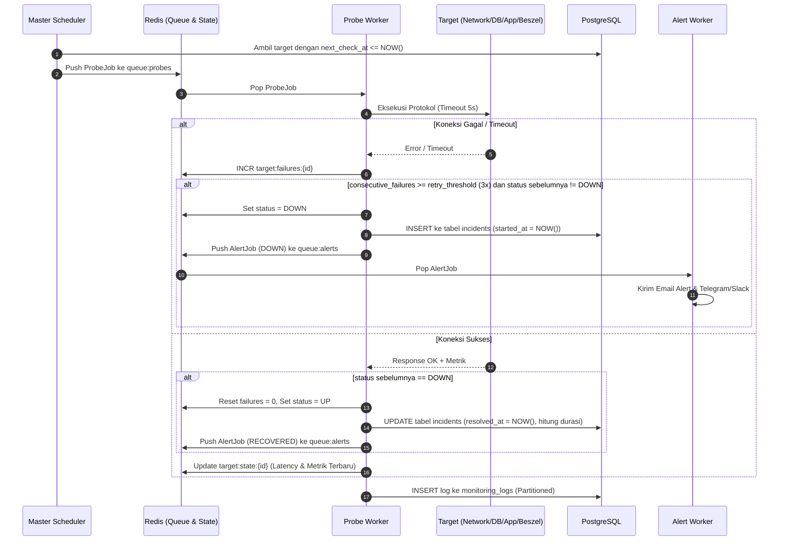
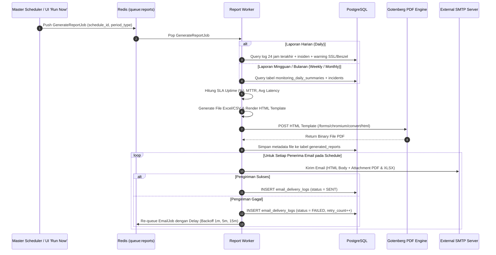

# Dokumen Arsitektur Aplikasi Web
## Sistem Monitoring Infrastruktur & Pelaporan Terpusat

| Informasi Dokumen | Detail |
| :--- | :--- |
| **Pola Arsitektur** | Event-Driven Modular Monolith with Asynchronous Priority Workers |
| **Stack Utama** | Laravel 11 (PHP 8.3) / Go Worker, PostgreSQL 16, Redis 7, Gotenberg PDF |
| **Lingkungan Deployment** | Docker Compose / Containerized Environment |
| **Versi** | 1.0 |

---

## 1. Ikhtisar Arsitektur (Architectural Overview)

Aplikasi ini dirancang dengan pendekatan **Event-Driven Modular Monolith** yang memisahkan secara ketat antara **Lapisan Antarmuka Web (HTTP Request-Response)** dan **Lapisan Pemrosesan Latar Belakang (Asynchronous Workers)**.

Prinsip utama arsitektur ini adalah:
1. **Zero Polling on Web Request:** Saat pengguna membuka salah satu dari 3 Dashboard, browser **tidak pernah** melakukan ping, cURL, atau koneksi ke target secara langsung. Browser hanya membaca status terakhir dari **Redis State Cache** dan metrik dari **PostgreSQL**.
2. **Prioritized Queue Isolation:** Antrean pekerjaan di Redis dipisah menjadi 3 jalur berdasarkan tingkat kekritisannya (`queue:alerts`, `queue:probes`, dan `queue:reports`) agar proses *generate* PDF bulanan tidak pernah menunda pengecekan *ping* jaringan atau pengiriman *alert* darurat.
3. **Pre-Aggregated Reporting (Data Rollup):** Laporan Mingguan dan Bulanan tidak dihitung dari jutaan baris log mentah pada saat jadwal dijalankan, melainkan diambil dari tabel agregasi harian (`monitoring_daily_summaries`) yang diolah setiap tengah malam.

---

## 2. Diagram Arsitektur Sistem (C4 Container Level)

```mermaid
graph TB
    subgraph Users["Pengguna & Stakeholder"]
        IT["Tim IT (SysAdmin, Dev, Network)"]
        MGR["IT Manager / Direksi"]
    end

    subgraph AppCore["Lingkungan Docker Aplikasi Monitoring"]
        WebUI["Web Application & CRUD UI<br/>(Nginx + Backend App)"]
        Scheduler["Master Cron Scheduler<br/>(Tick Tiap 1 Menit)"]
        Redis[("Redis 7<br/>1. State Cache<br/>2. Priority Queues")]
        
        subgraph Workers["Asynchronous Queue Workers"]
            AlertWorker["Alert Worker<br/>(queue:alerts)"]
            ProbeWorker["Probe Worker Pool<br/>(queue:probes)"]
            ReportWorker["Report & Rollup Worker<br/>(queue:reports)"]
        end

        Gotenberg["Gotenberg Microservice<br/>(Headless Chromium PDF Engine)"]
        Postgres[("PostgreSQL 16<br/>(Partitioned Logs & Rollup DB)")]
        Storage[("Report File Storage<br/>(PDF & XLSX Archives)")]
    end

    subgraph Targets["7 Kategori Target Monitoring"]
        T1["1. Network Internal<br/>(ICMP + SNMP + API)"]
        T2["2. Aplikasi Web<br/>(HTTP/HTTPS /health)"]
        T3["3. Domain Kantor<br/>(WHOIS + SSL + DNS)"]
        T4["4. Database Kantor<br/>(TCP Socket + SELECT 1)"]
        T5["5. Mail Server<br/>(SMTP/IMAP + DNSBL)"]
        T6["6. Object Storage S3<br/>(S3 SDK HeadBucket)"]
        T7["7. Server Beszel<br/>(PocketBase REST API)"]
    end

    subgraph ExternalNotif["Layanan Pengiriman Eksternal"]
        SMTP["External SMTP Relay<br/>(Email Report & Alert)"]
        Chat["Telegram / Slack Webhook<br/>(Failover Alert)"]
    end

    IT -->|Akses Dashboard & CRUD| WebUI
    WebUI -->|Baca/Tulis Konfigurasi| Postgres
    WebUI -->|Baca Status Real-Time| Redis
    WebUI -->|Trigger 'Run Now'| Redis

    Scheduler -->|Cek Jadwal Jatuh Tempo| Postgres
    Scheduler -->|Push Job| Redis

    Redis -->|Pop Prioritas 1| AlertWorker
    Redis -->|Pop Prioritas 2| ProbeWorker
    Redis -->|Pop Prioritas 3| ReportWorker

    ProbeWorker -->|Eksekusi Protokol| T1 & T2 & T3 & T4 & T5 & T6 & T7
    ProbeWorker -->|Simpan Log Mentah| Postgres
    ProbeWorker -->|Update Status & Retry Counter| Redis
    ProbeWorker -->|Trigger State-Change Alert| Redis

    ReportWorker -->|Baca Data Rollup| Postgres
    ReportWorker -->|Render HTML ke PDF| Gotenberg
    ReportWorker -->|Simpan File Laporan| Storage
    ReportWorker -->|Kirim Email Laporan| SMTP

    AlertWorker -->|Kirim Email Insiden| SMTP
    AlertWorker -->|Kirim Notifikasi Instan| Chat
    SMTP -->|Inbox Laporan & Alert| IT & MGR
```



---

## 3. Spesifikasi Teknis 5 Layer Arsitektur

### 3.1 Layer 1: Presentation & Management Layer (Web UI & CRUD)
* **Komponen Utama:**
  * **Modul NOC & 3 Dashboard:** Menggunakan komponen UI reaktif dengan dukungan *polling* ringan ke endpoint internal `/api/v1/dashboard/states` (membaca langsung dari Redis) untuk memperbarui indikator status dan grafik tanpa memuat ulang seluruh halaman.
  * **Modul CRUD & Credential Vault:** Mengelola entitas target monitoring, jadwal *Schedule Run*, serta penerima laporan. Seluruh kredensial dienkripsi menggunakan kunci simetris `APP_ENCRYPTION_KEY` dengan algoritma **AES-256-GCM** (menyimpan *cipher text*, *IV*, dan *auth tag*).

### 3.2 Layer 2: Orchestration & Queue Layer
* **Master Scheduler:** Berjalan sebagai proses tunggal (*singleton container*) yang mengeksekusi *loop* setiap $1\text{ detik}$ (untuk *health check*) dan setiap $1\text{ menit}$ (untuk *reporting schedule*).
* **Manajemen Antrean Redis (3 Jalur Prioritas):**
  1. `queue:alerts` — Waktu tunggu maksimal $< 1\text{ detik}$. Menangani pengiriman notifikasi perubahan status (`DOWN` / `RECOVERED`).
  2. `queue:probes` — Waktu tunggu maksimal $< 3\text{ detik}$. Menangani eksekusi pengecekan 7 jenis target secara konkurensi tinggi.
  3. `queue:reports` — Menangani proses agregasi data tengah malam (*Midnight Rollup*), pembuatan dokumen PDF/Excel, dan pengiriman email laporan terjadwal.

### 3.3 Layer 3: Modular Probe & Collector Engine
Menggunakan pola desain **Strategy / Adapter Pattern** melalui kontrak antarmuka `ProbeAdapterInterface`:

```
ProbeAdapterInterface
 ├── NetworkSnmpProbeAdapter     (ICMP Ping + SNMP OID Polling)
 ├── HttpHealthProbeAdapter      (cURL HTTP/HTTPS + JSON Schema Validator)
 ├── DomainSslProbeAdapter       (WHOIS Parser + OpenSSL X.509 Stream + DNS Lookup)
 ├── DatabasePingProbeAdapter    (TCP Handshake + Native PDO/Driver 'SELECT 1')
 ├── MailServerProbeAdapter      (SMTP/IMAP Socket Banner + DNSBL Reverse IP Check)
 ├── S3StorageProbeAdapter       (AWS S3 SDK v3 HeadBucket Request)
 └── BeszelApiProbeAdapter       (HTTP Client -> PocketBase REST API Token Auth)
```

**Detail Integrasi Khusus Beszel API:**
* Beszel menggunakan **PocketBase** sebagai *backend* di port `8090`.
* `BeszelApiProbeAdapter` melakukan autentikasi ke `/api/collections/_superusers/auth-with-password` (atau token statis), menyimpan token JWT di Redis selama $12\text{ jam}$, lalu menarik data dari:
  * `GET /api/collections/systems/records` (Status server, versi agen, *uptime*).
  * `GET /api/collections/system_stats/records?filter=(system='ID')&sort=-created&perPage=1` (CPU $\%$, Memori $\%$, Disk $\%$, Bandwidth, dan metrik kontainer Docker).

### 3.4 Layer 4: Data Persistence & Caching Layer
* **Redis State Structure:**
  * `target:state:{uuid}` $\rightarrow$ Menyimpan JSON status terkini (`status`, `last_latency_ms`, `consecutive_failures`, `last_checked_at`, `summary_metrics`).
  * Mencegah pembacaan berulang ke PostgreSQL saat mengecek apakah kegagalan sudah mencapai batas `retry_threshold` (misal $3\text{ kali}$).
* **PostgreSQL Partitioned Storage:**
  * Tabel `monitoring_logs` dipartisi secara deklaratif (`PARTITION BY RANGE (checked_at)`) per bulan (contoh: `monitoring_logs_2026_10`, `monitoring_logs_2026_11`).
  * Saat membersihkan log yang berusia lebih dari $90\text{ hari}$, sistem cukup menjalankan `DROP TABLE monitoring_logs_YYYY_MM;` tanpa menyebabkan *table lock* atau fragmentasi disk (*bloat*).

### 3.5 Layer 5: Reporting & Notification Dispatch Engine
* **Midnight Rollup Worker:** Berjalan setiap hari pukul `00:05 WIB` untuk menghitung agregasi log hari sebelumnya dan menyimpannya ke tabel `monitoring_daily_summaries`.
* **PDF Rendering Service (Gotenberg):**
  * Aplikasi merender laporan ke dalam template HTML + CSS + SVG Chart, lalu mengirimkannya via HTTP POST ke kontainer internal `gotenberg:3000/forms/chromium/convert/html`.
  * Gotenberg mengembalikan file PDF siap kirim yang kemudian disimpan ke disk dan dilampirkan ke email.

---

## 4. Alur Kerja Sistem (Sequence Diagrams)

### 4.1 Alur Pengecekan Protokol & Deteksi Insiden (State-Change)



### 4.2 Alur Schedule Run & Generate Report (Harian, Mingguan, Bulanan)



---

## 5. Struktur Direktori Proyek (Modular Monolith)

```text
monitoring-internal/
├── app/
│   ├── Console/
│   │   └── Commands/
│   │       ├── DispatchTargetProbesCommand.php      # Berjalan tiap detik/menit
│   │       ├── RunMidnightDataRollupCommand.php     # Agregasi harian 00:05 WIB
│   │       ├── DispatchScheduledReportsCommand.php  # Mengeksekusi Schedule Run Report
│   │       └── PruneOldMonitoringPartitions.php     # Hapus partisi > 90 hari
│   ├── Modules/
│   │   ├── Dashboard/                               # Controller & View 3 Dashboard + NOC
│   │   ├── Targets/                                 # CRUD Target + AES-256 Credential Service
│   │   ├── Probes/                                  # Mesin Pengecekan 7 Protokol
│   │   │   ├── Contracts/ProbeAdapterInterface.php
│   │   │   ├── Adapters/
│   │   │   │   ├── NetworkSnmpProbe.php
│   │   │   │   ├── HttpHealthProbe.php
│   │   │   │   ├── DomainSslProbe.php
│   │   │   │   ├── DatabasePingProbe.php
│   │   │   │   ├── MailServerProbe.php
│   │   │   │   ├── S3BucketProbe.php
│   │   │   │   └── BeszelApiProbe.php
│   │   │   └── Jobs/ExecuteTargetProbeJob.php
│   │   ├── Incidents/                               # Manajemen Insiden & State-Change Alert
│   │   └── Reporting/                               # Engine Report Harian/Mingguan/Bulanan
│   │       ├── Services/SlaCalculatorService.php
│   │       ├── Builders/PdfReportBuilder.php
│   │       ├── Builders/ExcelReportBuilder.php
│   │       └── Jobs/GenerateAndSendReportJob.php
├── config/
├── database/
│   ├── migrations/
│   └── seeders/
├── docker/
│   ├── app/Dockerfile                               # Termasuk iputils-ping, snmp, whois, openssl
│   └── nginx/default.conf
└── docker-compose.yml
```

---

## 6. Spesifikasi Topologi Kontainer (`docker-compose.yml`)

Berikut adalah rancangan konfigurasi kontainer untuk menjalankan seluruh arsitektur aplikasi secara terisolasi dan siap produksi:

```yaml
version: '3.9'

services:
  monitoring-web:
    build:
      context: .
      dockerfile: docker/app/Dockerfile
    container_name: monitoring-web
    restart: unless-stopped
    ports:
      - "8080:80"
    environment:
      - APP_ENV=production
      - DB_HOST=monitoring-postgres
      - REDIS_HOST=monitoring-redis
      - GOTENBERG_URL=http://monitoring-gotenberg:3000
    volumes:
      - report_storage:/var/www/html/storage/app/reports
    depends_on:
      - monitoring-postgres
      - monitoring-redis

  monitoring-scheduler:
    build:
      context: .
      dockerfile: docker/app/Dockerfile
    container_name: monitoring-scheduler
    restart: unless-stopped
    command: ["php", "artisan", "schedule:work"]
    depends_on:
      - monitoring-postgres
      - monitoring-redis

  monitoring-worker-probes:
    build:
      context: .
      dockerfile: docker/app/Dockerfile
    restart: unless-stopped
    command: ["php", "artisan", "queue:work", "redis", "--queue=alerts,probes", "--sleep=1", "--tries=1", "--timeout=15"]
    deploy:
      replicas: 3
    cap_add:
      - NET_RAW # Diperlukan untuk eksekusi paket ICMP Ping tingkat rendah
    depends_on:
      - monitoring-postgres
      - monitoring-redis

  monitoring-worker-reports:
    build:
      context: .
      dockerfile: docker/app/Dockerfile
    container_name: monitoring-worker-reports
    restart: unless-stopped
    command: ["php", "artisan", "queue:work", "redis", "--queue=reports", "--sleep=3", "--tries=3", "--backoff=60,300,900", "--timeout=120"]
    volumes:
      - report_storage:/var/www/html/storage/app/reports
    depends_on:
      - monitoring-postgres
      - monitoring-redis
      - monitoring-gotenberg

  monitoring-gotenberg:
    image: gotenberg/gotenberg:8
    container_name: monitoring-gotenberg
    restart: unless-stopped

  monitoring-postgres:
    image: postgres:16-alpine
    container_name: monitoring-postgres
    restart: unless-stopped
    environment:
      POSTGRES_DB: internal_monitoring
      POSTGRES_USER: mon_admin
      POSTGRES_PASSWORD: ${DB_PASSWORD}
    volumes:
      - pg_data:/var/lib/postgresql/data

  monitoring-redis:
    image: redis:7-alpine
    container_name: monitoring-redis
    restart: unless-stopped
    command: redis-server --appendonly yes
    volumes:
      - redis_data:/data

volumes:
  pg_data:
  redis_data:
  report_storage:
```