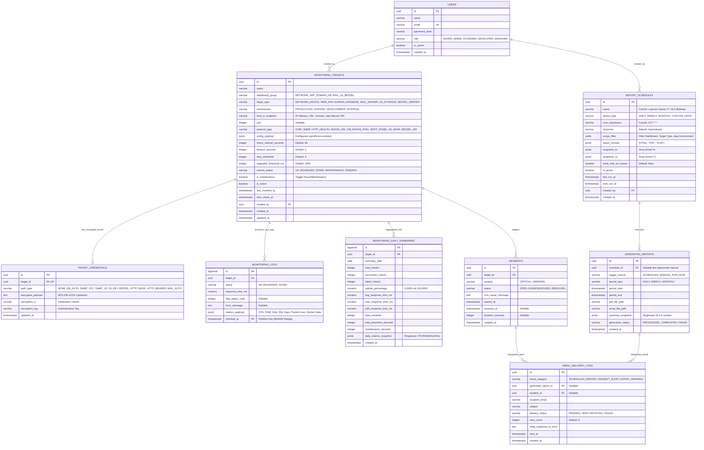

# Dokumen Entity-Relationship Diagram (ERD) & Skema Database
## Sistem Monitoring Infrastruktur & Pelaporan Terpusat

Dokumen ini memuat rancangan relasi entitas (ERD), struktur *polymorphic JSONB* untuk mendukung 7 jenis target yang berbeda secara fleksibel dalam satu tabel utama, serta skrip DDL SQL PostgreSQL 16 lengkap.

---

## 1. Visualisasi Entity-Relationship Diagram (ERD)



---

## 2. Desain Struktur JSONB (`config_payload` & `metrics_payload`)

Agar fitur CRUD dapat menangani **7 jenis target yang memiliki atribut berbeda** tanpa harus membuat 7 tabel terpisah yang kaku, kolom `config_payload` pada `monitoring_targets` dan `metrics_payload` pada `monitoring_logs` dirancang dengan skema JSONB terstandarisasi berikut:

| Kategori Target (`target_type`) | Contoh `config_payload` (pada `monitoring_targets`) | Contoh `metrics_payload` (pada `monitoring_logs`) |
| :--- | :--- | :--- |
| **1. `NETWORK_DEVICE`** *(Router, Switch, AP, Server)* | `{"sub_type": "ROUTER", "icmp_count": 4, "enable_snmp": true, "snmp_version": "2c", "interfaces": ["ether1-wan", "bridge-lan"]}` | `{"packet_loss_pct": 0, "jitter_ms": 1.2, "cpu_usage_pct": 24.5, "mem_usage_pct": 48.0, "rx_mbps": 85.4, "tx_mbps": 42.1}` |
| **2. `WEB_APP`** *(Prod, Staging, Dev)* | `{"method": "GET", "expected_status": 200, "verify_ssl": true, "expected_json_key": "status", "expected_json_value": "ok"}` | `{"dns_lookup_ms": 4.2, "tcp_connect_ms": 12.1, "tls_handshake_ms": 28.5, "ttfb_ms": 110.4, "ssl_days_remaining": 64}` |
| **3. `DOMAIN`** | `{"whois_server": "whois.id", "check_ssl_port": 443, "expected_a_records": ["203.0.113.10"], "warn_days_before": 14}` | `{"domain_Status": "active", "domain_expiry_date": "2027-05-20", "domain_days_left": 217, "ssl_issuer": "Let's Encrypt", "ssl_expiry_date": "2026-12-10", "ssl_days_left": 56, "dns_resolved_ip": "203.0.113.10"}` |
| **4. `DATABASE`** *(Prod, Staging, Dev)* | `{"db_driver": "pgsql", "database_name": "erp_prod", "query": "SELECT 1", "collect_connection_stats": true}` | `{"tcp_handshake_ms": 1.8, "query_exec_ms": 3.4, "active_connections": 42, "max_connections": 200}` |
| **5. `MAIL_SERVER`** | `{"check_ports": {"smtp": 587, "imap": 993}, "check_dnsbl": true, "dnsbl_providers": ["zen.spamhaus.org", "bl.spamcop.net"]}` | `{"smtp_587_up": true, "imap_993_up": true, "smtp_banner": "220 mail.kantor.co.id ESMTP Postfix", "is_blacklisted": false, "listed_on": [], "spf_valid": true, "dmarc_valid": true}` |
| **6. `S3_STORAGE`** | `{"region": "ap-southeast-1", "bucket_name": "kantor-backup-prod", "use_path_style_endpoint": true}` | `{"bucket_accessible": true, "head_bucket_ms": 45.2, "signature_version": "v4"}` |
| **7. `BESZEL_SERVER`** | `{"beszel_system_id": "rec_xyz123456", "warn_cpu_pct": 85, "warn_mem_pct": 90, "warn_disk_pct": 85}` | `{"agent_status": "up", "cpu_pct": 18.4, "mem_used_gb": 6.2, "mem_total_gb": 16.0, "mem_pct": 38.7, "disk_used_gb": 120.5, "disk_total_gb": 500.0, "disk_pct": 24.1, "containers_running": 12, "containers_unhealthy": 0}` |

---

## 3. Skrip DDL SQL Lengkap (PostgreSQL 16+)

Skrip di bawah ini siap dieksekusi pada PostgreSQL 16+ untuk membangun seluruh tabel, indeks performa, dan partisi log otomatis.

```sql
-- Aktifkan ekstensi UUID
CREATE EXTENSION IF NOT EXISTS "pgcrypto";

-- ============================================================================
-- 1. TABEL PENGGUNA (USERS)
-- ============================================================================
CREATE TABLE users (
    id UUID PRIMARY KEY DEFAULT gen_random_uuid(),
    name VARCHAR(120) NOT NULL,
    email VARCHAR(150) UNIQUE NOT NULL,
    password_hash VARCHAR(255) NOT NULL,
    role VARCHAR(30) NOT NULL CHECK (role IN ('SUPER_ADMIN', 'SYSADMIN', 'DEVELOPER', 'MANAGER')),
    is_active BOOLEAN NOT NULL DEFAULT TRUE,
    created_at TIMESTAMPTZ NOT NULL DEFAULT NOW(),
    updated_at TIMESTAMPTZ NOT NULL DEFAULT NOW()
);

-- ============================================================================
-- 2. TABEL TARGET MONITORING (MONITORING_TARGETS) - MENDUKUNG CRUD 7 TARGET
-- ============================================================================
CREATE TABLE monitoring_targets (
    id UUID PRIMARY KEY DEFAULT gen_random_uuid(),
    name VARCHAR(150) NOT NULL,
    dashboard_group VARCHAR(30) NOT NULL CHECK (
        dashboard_group IN ('NETWORK', 'APP_DOMAIN_DB', 'MAIL_S3_BESZEL')
    ),
    target_type VARCHAR(30) NOT NULL CHECK (
        target_type IN (
            'NETWORK_DEVICE', 
            'WEB_APP', 
            'DOMAIN', 
            'DATABASE', 
            'MAIL_SERVER', 
            'S3_STORAGE', 
            'BESZEL_SERVER'
        )
    ),
    environment VARCHAR(20) NOT NULL DEFAULT 'INTERNAL' CHECK (
        environment IN ('PRODUCTION', 'STAGING', 'DEVELOPMENT', 'INTERNAL')
    ),
    host_or_endpoint VARCHAR(255) NOT NULL,
    port INTEGER NULL CHECK (port IS NULL OR (port >= 1 AND port <= 65535)),
    protocol_type VARCHAR(30) NOT NULL CHECK (
        protocol_type IN (
            'ICMP_SNMP', 
            'HTTP_HEALTH', 
            'WHOIS_SSL', 
            'DB_NATIVE_PING', 
            'SMTP_DNSBL', 
            'S3_HEAD', 
            'BESZEL_API'
        )
    ),
    config_payload JSONB NOT NULL DEFAULT '{}'::jsonb,
    check_interval_seconds INTEGER NOT NULL DEFAULT 60 CHECK (check_interval_seconds >= 10),
    timeout_seconds INTEGER NOT NULL DEFAULT 5 CHECK (timeout_seconds >= 1 AND timeout_seconds <= 60),
    retry_threshold INTEGER NOT NULL DEFAULT 3 CHECK (retry_threshold >= 1 AND retry_threshold <= 10),
    degraded_threshold_ms INTEGER NOT NULL DEFAULT 1000,
    current_status VARCHAR(20) NOT NULL DEFAULT 'PENDING' CHECK (
        current_status IN ('UP', 'DEGRADED', 'DOWN', 'MAINTENANCE', 'PENDING')
    ),
    is_maintenance BOOLEAN NOT NULL DEFAULT FALSE,
    is_active BOOLEAN NOT NULL DEFAULT TRUE,
    last_checked_at TIMESTAMPTZ NULL,
    next_check_at TIMESTAMPTZ NOT NULL DEFAULT NOW(),
    created_by UUID REFERENCES users(id) ON DELETE SET NULL,
    created_at TIMESTAMPTZ NOT NULL DEFAULT NOW(),
    updated_at TIMESTAMPTZ NOT NULL DEFAULT NOW()
);

CREATE INDEX idx_targets_scheduler ON monitoring_targets (is_active, is_maintenance, next_check_at);
CREATE INDEX idx_targets_dashboard_env ON monitoring_targets (dashboard_group, target_type, environment);

-- ============================================================================
-- 3. TABEL KREDENSIAL TERENKRIPSI AES-256 (TARGET_CREDENTIALS)
-- ============================================================================
CREATE TABLE target_credentials (
    id UUID PRIMARY KEY DEFAULT gen_random_uuid(),
    target_id UUID NOT NULL UNIQUE REFERENCES monitoring_targets(id) ON DELETE CASCADE,
    auth_type VARCHAR(30) NOT NULL CHECK (
        auth_type IN ('NONE', 'DB_AUTH', 'SNMP_V2C', 'SNMP_V3', 'S3_KEY', 'BESZEL', 'HTTP_BASIC', 'HTTP_BEARER', 'MAIL_AUTH')
    ),
    encrypted_payload TEXT NOT NULL,
    encryption_iv VARCHAR(64) NOT NULL,
    encryption_tag VARCHAR(64) NOT NULL,
    updated_at TIMESTAMPTZ NOT NULL DEFAULT NOW()
);

-- ============================================================================
-- 4. TABEL LOG PENGECEKAN MENTAH (MONITORING_LOGS) - PARTITIONED BY MONTH
-- ============================================================================
CREATE TABLE monitoring_logs (
    id BIGSERIAL,
    target_id UUID NOT NULL,
    status VARCHAR(20) NOT NULL CHECK (status IN ('UP', 'DEGRADED', 'DOWN')),
    response_time_ms NUMERIC(10, 2) NULL,
    http_status_code INTEGER NULL,
    error_message TEXT NULL,
    metrics_payload JSONB NOT NULL DEFAULT '{}'::jsonb,
    checked_at TIMESTAMPTZ NOT NULL DEFAULT NOW(),
    PRIMARY KEY (id, checked_at)
) PARTITION BY RANGE (checked_at);

CREATE INDEX idx_monitoring_logs_target_time ON monitoring_logs (target_id, checked_at DESC);

-- Contoh pembuatan partisi bulanan (Otomatis dibuat oleh Scheduler setiap akhir bulan)
CREATE TABLE monitoring_logs_2026_10 PARTITION OF monitoring_logs
    FOR VALUES FROM ('2026-10-01 00:00:00+07') TO ('2026-11-01 00:00:00+07');

CREATE TABLE monitoring_logs_2026_11 PARTITION OF monitoring_logs
    FOR VALUES FROM ('2026-11-01 00:00:00+07') TO ('2026-12-01 00:00:00+07');

-- ============================================================================
-- 5. TABEL AGREGASI HARIAN / ROLLUP (MONITORING_DAILY_SUMMARIES)
-- Sumber Data Utama untuk Generate Report Mingguan & Bulanan
-- ============================================================================
CREATE TABLE monitoring_daily_summaries (
    id BIGSERIAL PRIMARY KEY,
    target_id UUID NOT NULL REFERENCES monitoring_targets(id) ON DELETE CASCADE,
    summary_date DATE NOT NULL,
    total_checks INTEGER NOT NULL DEFAULT 0,
    successful_checks INTEGER NOT NULL DEFAULT 0,
    failed_checks INTEGER NOT NULL DEFAULT 0,
    uptime_percentage NUMERIC(7, 4) NOT NULL DEFAULT 100.0000,
    avg_response_time_ms NUMERIC(10, 2) NOT NULL DEFAULT 0.00,
    max_response_time_ms NUMERIC(10, 2) NOT NULL DEFAULT 0.00,
    p95_response_time_ms NUMERIC(10, 2) NOT NULL DEFAULT 0.00,
    total_incidents INTEGER NOT NULL DEFAULT 0,
    total_downtime_seconds INTEGER NOT NULL DEFAULT 0,
    maintenance_seconds INTEGER NOT NULL DEFAULT 0,
    daily_metrics_snapshot JSONB NOT NULL DEFAULT '{}'::jsonb,
    created_at TIMESTAMPTZ NOT NULL DEFAULT NOW(),
    UNIQUE (target_id, summary_date)
);

CREATE INDEX idx_daily_summaries_date_target ON monitoring_daily_summaries (summary_date DESC, target_id);

-- ============================================================================
-- 6. TABEL INSIDEN & DOWNTIME (INCIDENTS)
-- ============================================================================
CREATE TABLE incidents (
    id UUID PRIMARY KEY DEFAULT gen_random_uuid(),
    target_id UUID NOT NULL REFERENCES monitoring_targets(id) ON DELETE CASCADE,
    severity VARCHAR(20) NOT NULL DEFAULT 'CRITICAL' CHECK (severity IN ('CRITICAL', 'WARNING')),
    status VARCHAR(20) NOT NULL DEFAULT 'OPEN' CHECK (status IN ('OPEN', 'ACKNOWLEDGED', 'RESOLVED')),
    root_cause_message TEXT NOT NULL,
    started_at TIMESTAMPTZ NOT NULL DEFAULT NOW(),
    resolved_at TIMESTAMPTZ NULL,
    duration_seconds INTEGER NULL,
    created_at TIMESTAMPTZ NOT NULL DEFAULT NOW()
);

CREATE INDEX idx_incidents_target_started ON incidents (target_id, started_at DESC);
CREATE INDEX idx_incidents_open ON incidents (status) WHERE status != 'RESOLVED';

-- ============================================================================
-- 7. TABEL KONFIGURASI SCHEDULE RUN & LAPORAN (REPORT_SCHEDULES)
-- ============================================================================
CREATE TABLE report_schedules (
    id UUID PRIMARY KEY DEFAULT gen_random_uuid(),
    name VARCHAR(150) NOT NULL,
    period_type VARCHAR(20) NOT NULL CHECK (period_type IN ('DAILY', 'WEEKLY', 'MONTHLY', 'CUSTOM_CRON')),
    cron_expression VARCHAR(60) NOT NULL,
    timezone VARCHAR(50) NOT NULL DEFAULT 'Asia/Jakarta',
    scope_filter JSONB NOT NULL DEFAULT '{"dashboard_groups": ["ALL"], "environments": ["ALL"]}'::jsonb,
    report_formats JSONB NOT NULL DEFAULT '["HTML", "PDF", "XLSX"]'::jsonb,
    recipients_to JSONB NOT NULL DEFAULT '[]'::jsonb,
    recipients_cc JSONB NOT NULL DEFAULT '[]'::jsonb,
    send_only_on_issues BOOLEAN NOT NULL DEFAULT FALSE,
    is_active BOOLEAN NOT NULL DEFAULT TRUE,
    last_run_at TIMESTAMPTZ NULL,
    next_run_at TIMESTAMPTZ NOT NULL,
    created_by UUID REFERENCES users(id) ON DELETE SET NULL,
    created_at TIMESTAMPTZ NOT NULL DEFAULT NOW(),
    updated_at TIMESTAMPTZ NOT NULL DEFAULT NOW()
);

CREATE INDEX idx_report_schedules_next_run ON report_schedules (is_active, next_run_at);

-- ============================================================================
-- 8. TABEL ARSIP LAPORAN YANG DIGENERATE (GENERATED_REPORTS)
-- ============================================================================
CREATE TABLE generated_reports (
    id UUID PRIMARY KEY DEFAULT gen_random_uuid(),
    schedule_id UUID NULL REFERENCES report_schedules(id) ON DELETE SET NULL,
    trigger_source VARCHAR(20) NOT NULL CHECK (trigger_source IN ('SCHEDULED', 'MANUAL_RUN_NOW')),
    period_type VARCHAR(20) NOT NULL CHECK (period_type IN ('DAILY', 'WEEKLY', 'MONTHLY')),
    period_start TIMESTAMPTZ NOT NULL,
    period_end TIMESTAMPTZ NOT NULL,
    pdf_file_path VARCHAR(255) NULL,
    excel_file_path VARCHAR(255) NULL,
    summary_snapshot JSONB NOT NULL DEFAULT '{}'::jsonb,
    generation_status VARCHAR(20) NOT NULL DEFAULT 'PROCESSING' CHECK (
        generation_status IN ('PROCESSING', 'COMPLETED', 'FAILED')
    ),
    created_at TIMESTAMPTZ NOT NULL DEFAULT NOW()
);

-- ============================================================================
-- 9. TABEL AUDIT LOG PENGIRIMAN EMAIL (EMAIL_DELIVERY_LOGS)
-- ============================================================================
CREATE TABLE email_delivery_logs (
    id UUID PRIMARY KEY DEFAULT gen_random_uuid(),
    email_category VARCHAR(30) NOT NULL CHECK (
        email_category IN ('SCHEDULED_REPORT', 'INCIDENT_ALERT', 'EXPIRY_WARNING')
    ),
    generated_report_id UUID NULL REFERENCES generated_reports(id) ON DELETE CASCADE,
    incident_id UUID NULL REFERENCES incidents(id) ON DELETE CASCADE,
    recipient_email VARCHAR(150) NOT NULL,
    subject VARCHAR(255) NOT NULL,
    delivery_status VARCHAR(20) NOT NULL DEFAULT 'PENDING' CHECK (
        delivery_status IN ('PENDING', 'SENT', 'RETRYING', 'FAILED')
    ),
    retry_count INTEGER NOT NULL DEFAULT 0,
    smtp_response_or_error TEXT NULL,
    sent_at TIMESTAMPTZ NULL,
    created_at TIMESTAMPTZ NOT NULL DEFAULT NOW()
);

CREATE INDEX idx_email_logs_status_created ON email_delivery_logs (delivery_status, created_at DESC);
```